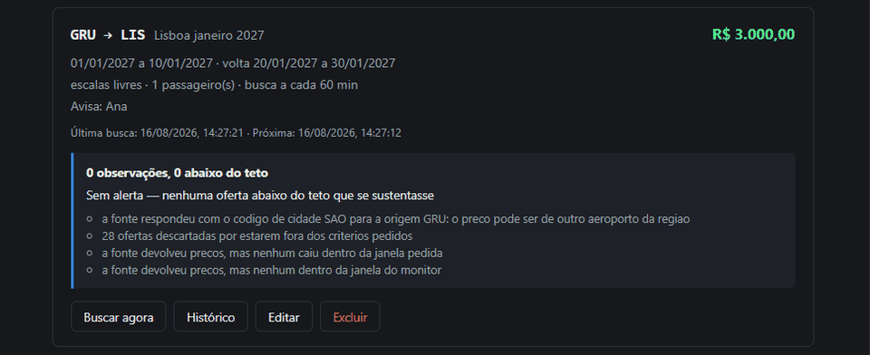
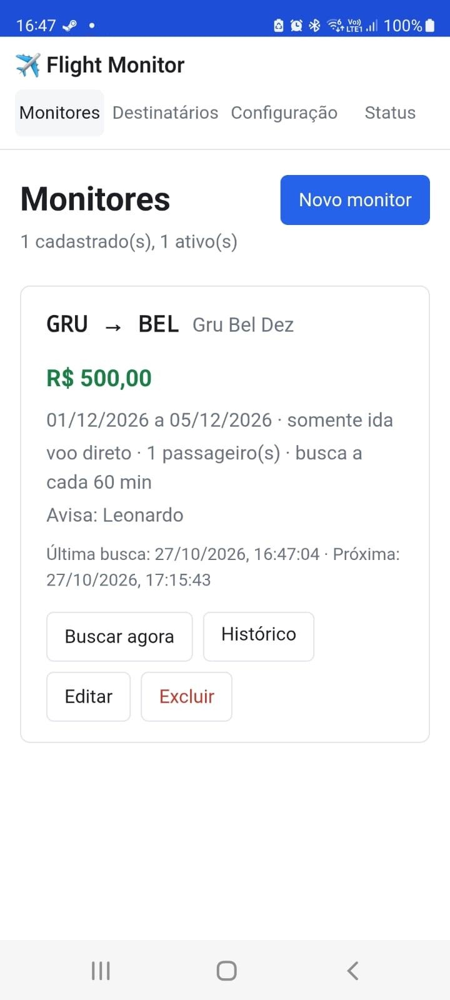
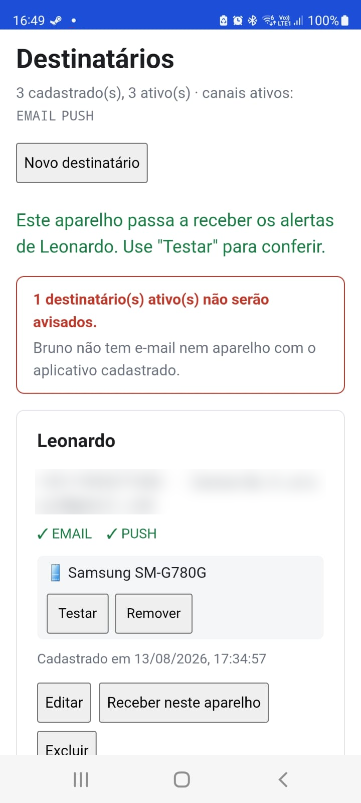
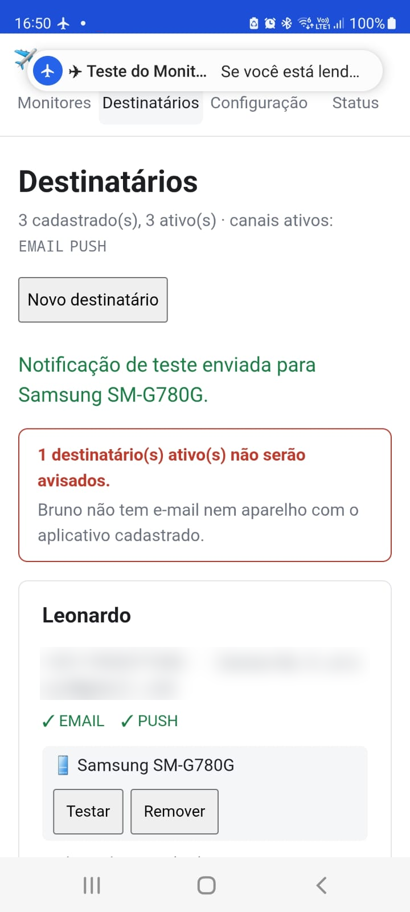
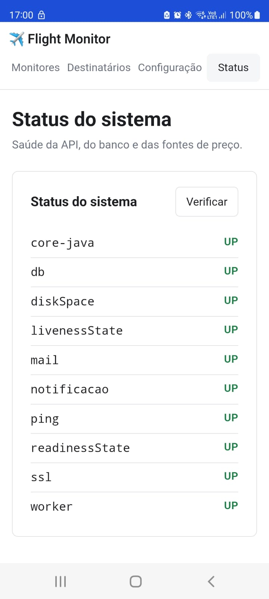

# Flight Monitor — Monitor de Preços de Passagens Aéreas

**Sistema distribuído que vigia rotas aéreas em background e avisa no celular, no WhatsApp ou no e-mail quando encontra uma oferta dentro do seu preço-teto — com análise estatística e decisão sobre quando realmente notificar.**

[](https://openjdk.org)
[](https://spring.io/projects/spring-boot)
[](https://www.python.org)
[](https://fastapi.tiangolo.com)
[](https://vuejs.org)
[](./mobile-android/)
[](https://www.postgresql.org)
[](https://www.rabbitmq.com)
[](./docker-compose.yml)
[](#-qualidade)
[](./LICENSE)

[🎯 Motivação](#-motivação) · [🐳 Subir em 2 minutos](#-como-rodar-o-projeto) · [📐 Diagramas interativos](./diagrams/) · [📚 Documentação](#-documentação)

---

## 🎯 Motivação

Moro em **São Paulo**, mas sou natural de **Belém do Pará**. Viajo para lá pelo menos uma vez por
ano, e minha família faz o caminho inverso para me visitar aqui. É um trecho que se repete — e que
quase nunca está barato justamente nos meses em que dá para viajar.

Preço de passagem muda o tempo todo. A mesma data custa uma coisa hoje e outra amanhã, às vezes
com poucas horas de diferença. A oferta boa aparece e some. Acompanhar isso à mão significa abrir
o site várias vezes por dia, durante meses — e mesmo assim passar batido bem na hora em que o
preço caiu.

**Ninguém tem tempo de monitorar preço de passagem 24 horas por dia. Um programa tem.**

Já existem ferramentas que fazem algo parecido. Decidi construir esta do zero por dois motivos que
andam juntos: **resolver um problema meu de verdade** e **pôr em prática o que sei de engenharia
de software** — arquitetura, testes, integração com fontes instáveis e gratuitas, e as decisões
que só aparecem quando o sistema precisa funcionar sozinho, sem ninguém olhando.

---

## 📸 Demonstração

Um monitor é uma rota, uma janela de datas e um preço-teto. É tudo o que o sistema precisa para
começar a vigiar sozinho:


> **Cadastro de monitor** — a volta é opcional e aceita duas formas: janela de datas *ou*
> permanência em dias. O intervalo entre buscas tem **mínimo de 10 minutos**, e o porquê fica
> escrito ao lado do campo: as fontes são gratuitas e a camada 1 devolve preço em cache, então
> varrer mais rápido só gasta cota para reler o mesmo dado.

Cada monitor mostra o que fez na última varredura — inclusive quando **não** achou nada:



> **Busca sob demanda e diagnóstico** — este é o princípio de *dizer o que não se sabe* na tela.
> Em vez de uma lista vazia sem explicação, o sistema enumera os motivos: a fonte respondeu com o
> código de cidade `SAO` em vez do aeroporto `GRU`, 28 ofertas caíram fora dos critérios, e nenhuma
> das que sobraram entrou na janela pedida. Silêncio com motivo é diferente de silêncio por falha.

Quando há histórico suficiente, ele vira gráfico e tabela:


> **Histórico do monitor** — o gráfico separa o que **cabe no teto** do que está acima dele, com a
> linha tracejada do seu limite. Na tabela, cada linha é um preço visto numa varredura, e três
> colunas carregam decisões de projeto: **Companhia / Agência** distingue quem opera o voo de quem
> o vende (`Iberia` é companhia, `Trip.com` é agência), **Duração** e **Escalas** só existem quando
> a fonte informou — traço significa ausente, não zero — e **Fonte** diz se o preço veio do `cache`
> da camada 1 ou foi `confirmado` na camada 2.

Quando um voo cabe nos critérios, chega uma mensagem — no celular, no WhatsApp, no e-mail ou no
log. Cada destinatário recebe por **todos** os canais ativos que o alcançam:

```
✈️ Oportunidade encontrada

GRU → SSA
05/10/2026 → 17/10/2026

Iberia · 1 escala
R$ 3.720,00
Seu limite: R$ 5.000,00  (R$ 1.280,00 abaixo)
```

| Painel | O que faz |
|--------|-----------|
| **Monitores** | Cadastro de rotas, janelas e teto, com varredura sob demanda |
| **Histórico** | Gráfico de menor preço por data de partida, com tabela de observações |
| **Destinatários** | Quem recebe, por telefone, e-mail e/ou aparelho, com aviso de quem **não** será alcançado |
| **Configuração** | Template e número do WhatsApp editáveis sem reiniciar o sistema |
| **Status** | Saúde da API, do banco, do worker e dos canais de notificação |

### 📱 App Android

O painel inteiro também roda como app Android — o mesmo Vue, dentro de um WebView. Tudo que se faz
no navegador se faz no app, e o app acrescenta o que o navegador não tem: **notificação push**.

<table>
  <tr>
    <td align="center" width="25%"></td>
    <td align="center" width="25%"></td>
    <td align="center" width="25%"></td>
    <td align="center" width="25%"></td>
  </tr>
  <tr>
    <td align="center"><sub><b>Monitores</b></sub></td>
    <td align="center"><sub><b>Destinatários e aparelhos</b></sub></td>
    <td align="center"><sub><b>Push chegando</b></sub></td>
    <td align="center"><sub><b>Status</b></sub></td>
  </tr>
</table>

> **Receber neste aparelho** — no cartão do destinatário, um toque pede a permissão de notificação
> do Android, obtém o token do Firebase e registra o celular. **Testar** manda uma notificação na
> hora, para conferir o caminho inteiro sem esperar um preço cair. Tocar num alerta abre o app
> direto no monitor que o disparou. O painel só sabe que está dentro do app por uma ponte
> JavaScript (`window.FlightMonitorApp`); no navegador, o botão simplesmente não aparece.

---

## 🧑‍💻 Sobre o Projeto

Monitorar preço de passagem à mão não funciona: o preço muda em minutos e ninguém abre o site dez vezes por dia durante três meses. Este sistema faz isso em background e **só incomoda quando há oportunidade real**.

São **três serviços independentes** e uma decisão de projeto que atravessa tudo: **dizer o que não se sabe**. Sem histórico suficiente, o sistema se cala em vez de opinar — não há nota, não há comparação com a mediana, não há "tendência preliminar". `SEM_DADOS` é diferente de `NORMAL`, e nulo é diferente de zero.

Essa mesma disciplina aparece na entrega: `ACCEPTED` (a Meta recebeu) e `DELIVERED` (chegou no aparelho) são estados **diferentes**, porque um bug ensinou que confundi-los custa caro.

---

## ✨ Funcionalidades

- **Coleta em duas camadas** — Travelpayouts varre o mês inteiro numa chamada (barato, amplo); fast-flights confirma o candidato antes de alertar (caro, preciso). **Nada é alertado sem confirmação**
- **Quatro canais de notificação, vários ao mesmo tempo** — push no app Android (Firebase Cloud Messaging), WhatsApp Cloud API, e-mail por SMTP e log, atrás da mesma interface. Cada destinatário recebe por todos os canais ativos que o alcançam, e quem não é alcançado por nenhum aparece em vermelho no painel
- **App Android** — o painel num WebView, com a senha lembrada e push nativo. Token recusado pelo Firebase (app desinstalado, dados limpos) desliga o aparelho sozinho, em vez de falhar para sempre
- **Flight Score** — nota de 0 a 100 ponderando preço, escalas, duração, horário e companhia, com preferências por monitor
- **Detecção de anomalia** — regra de Tukey (`p25 − 1,5 × IQR`) sobre o histórico da rota, para distinguir "barato" de "barato de verdade"
- **Tendência de preço** — regressão de Theil–Sen, robusta a outliers, respondendo se a rota está subindo ou caindo
- **Agente em linguagem natural** — cria monitores e responde recomendações a partir de frases como *"quero ir pra Lisboa em março por até 3 mil"*
- **Anti-spam** — janela de silêncio por monitor, para uma queda de preço não virar dez mensagens
- **Confirmação de entrega** — webhook da Meta atualiza `DELIVERED` e `READ`, distinguindo "aceito" de "chegou"
- **Dois transportes** — REST síncrono ou RabbitMQ, escolhidos por configuração, atrás da mesma porta
- **Degradação honesta** — fonte fora do ar vira aviso explícito, e nunca "nenhuma oferta encontrada"
- **Arquitetura verificada por teste** — BCE por feature nos três módulos, com ArchUnit, AST de imports e Vitest reprovando o build quando uma camada é quebrada

---

## 🛠️ Tecnologias

| Categoria | Tecnologia | Versão |
|-----------|-----------|--------|
| Backend principal | Java + Spring Boot | 21 / 4.1 |
| Worker de coleta | Python + FastAPI | 3.14 / 0.141 |
| Frontend | Vue + Vite + TypeScript | 3.5 / 8.2 / 6.0 |
| App Android | Kotlin + WebView + Firebase Cloud Messaging | 1.9 / Android 8+ |
| Push no servidor | FCM HTTP v1 + google-auth-library | 1.48 |
| Banco de dados | PostgreSQL + Flyway | 17 / 12 |
| Mensageria | RabbitMQ | 4 |
| Contêineres | Docker Compose | 5 serviços |
| Testes (Java) | JUnit 5 + AssertJ + WireMock + GreenMail | — |
| Testes (Python) | pytest | — |
| Testes (frontend) | Vitest | 3.2 |
| Arquitetura | ArchUnit | 1.4 |

**Conceitos e padrões aplicados:**

- **BCE (Boundary–Control–Entity) por feature** — camadas dentro de cada funcionalidade, não pastas globais
- **Ports & Adapters** — o controle define a porta; a borda implementa. Trocar REST por AMQP não tocou no motor
- **Estatística robusta** — mediana, quartis e Theil–Sen no lugar de média e mínimos quadrados, porque preço de passagem tem cauda longa
- **Request/reply sobre AMQP** com `SmartMessageConverter` e dead-letter exchange
- **Falha transitória × permanente** — classificadas uma a uma, para retentativa ser útil em vez de teimosa
- **Migrations aditivas** — Flyway com `CHECK` no banco duplicando a validação da aplicação, de propósito
- **Composition root** isolada no worker, para HTTP e AMQP montarem exatamente a mesma cadeia

---

## 🏗️ Arquitetura


| Componente | Stack | Porta | Papel |
|---|---|---|---|
| `core-java/` | Java 21 + Spring Boot 4.1 | 8081 | API, agendamento, persistência, regras de alerta |
| `worker-python/` | Python 3.14 + FastAPI | 8001 | Busca de preços e linguagem natural |
| `frontend-vue/` | Vue 3 + Vite + TypeScript | 8090 | Painel de monitores, histórico e destinatários |
| `mobile-android/` | Kotlin + WebView + FCM | — | O painel no celular, com notificação push |
| PostgreSQL | Docker | 5433 | Histórico de preços |
| RabbitMQ | Docker | 5672 · 15672 | Transporte alternativo entre core e worker |

**Quatro regras invioláveis** sustentam o desenho:

1. **O Java é o dono do banco** — o worker nunca acessa o PostgreSQL. Um teste falha se alguém importar um driver de banco lá dentro
2. **O worker é um especialista burro** — não conhece monitores nem destinatários, e não decide se um preço é bom
3. **O canal de notificação fica atrás de uma interface** — o motor não sabe que WhatsApp ou Firebase existem
4. **Toda fonte de preço é um provider plugável** — se uma cai, o sistema degrada em vez de morrer

### Coleta em duas camadas


1. **Travelpayouts** — varredura ampla. Devolve o preço mais barato de cada dia de um mês inteiro numa chamada. Gratuita e estável, mas com dados cacheados
2. **fast-flights** — confirmação pontual via Google Flights. Traz companhia, escalas e horários. Gratuita, e frágil por depender do formato interno do Google

Repare no último passo do diagrama: o preço confirmado **ainda pode não virar alerta**. Teto, anti-spam e análise decidem depois.

**Quando a camada 1 não enxerga a janela**, a camada 2 entra como reserva. O cache da
Travelpayouts só tem as datas que alguém pesquisou recentemente, e sem a reserva um monitor
nessas datas buscaria para sempre sem gravar nada. Para monitor de só ida com janela de até 7
dias, o Google é consultado direto, dia a dia, no máximo a cada 3 horas
([D-114](docs/DECISOES.md)).

### Ciclo de vida do alerta


`ACCEPTED` e `SENT` não são a mesma coisa. No WhatsApp o alerta para em `ACCEPTED` até o webhook da Meta chegar — *a Meta recebeu* não é *chegou no aparelho*. No e-mail não há webhook nenhum, então `SENT` quer dizer "o servidor SMTP aceitou", e é tudo que dá para afirmar com honestidade. No push vale o mesmo: `SENT` é "o Firebase aceitou para pelo menos um aparelho".

### Da observação de preço à decisão


> Os diagramas acima são retratos estáticos. As versões **interativas** — com rastreamento de rota, visões guiadas e tema claro/escuro — estão em **[diagrams/](./diagrams/)**, junto de como foram geradas.

---

## 📂 Estrutura do Projeto

```
3layers-flightmonitor/
├── core-java/                        ← API, banco, agendamento, alertas
│   └── src/main/java/com/flightmonitor/core/
│       ├── monitor/                  ← entity · control · boundary
│       ├── alert/                    ← canais: whatsapp/ · email/ · push/ · log
│       ├── search/                   ← cliente do worker: REST e AMQP
│       ├── stats/                    ← anomalia, score, tendência
│       ├── agent/                    ← linguagem natural
│       └── recipient/                ← quem recebe, e em quais aparelhos
├── worker-python/                    ← especialista em buscar preço
│   └── app/
│       ├── boundary/                 ← http/ e amqp/ (entrada) · gateway/ (saída)
│       ├── control/                  ← portas e cadeias de providers
│       └── composicao/               ← raiz de composição
├── frontend-vue/                     ← painel
│   └── src/
│       ├── api/                      ← http.ts é o transporte; um módulo por recurso
│       ├── model/                    ← domínio e funções puras
│       ├── lib/ · composables/       ← formatação, estado reativo e a ponte com o app
│       └── views/ · components/
├── mobile-android/                   ← app Android: WebView + Firebase Cloud Messaging
├── diagrams/                         ← diagramas archify (HTML interativo + SVG)
├── docs/                             ← plano, diário, decisões e bugs
├── scripts/                          ← E2E entre serviços, extração de SVG
├── docker-compose.yml                ← os 5 containers
└── docker-compose.prod.yml           ← produção: banco em outra máquina, painel com senha
```

---

## 🚀 Como Rodar o Projeto

### Pré-requisitos

- [Docker](https://www.docker.com) com Docker Compose
- Nada mais — nenhuma chave de API é necessária para subir

### Instalação e Execução

```bash
# 1. Clone o repositório
git clone https://github.com/holandale0/3layers-flightmonitor.git

# 2. Acesse a pasta do projeto
cd 3layers-flightmonitor

# 3. Copie o arquivo de ambiente de exemplo
cp .env.example .env

# 4. Suba os 5 containers
docker compose up -d
```

Acesse em: **http://localhost:8090**

Sobem cinco containers e todos ficam saudáveis **sem nenhuma chave de API**. O canal padrão é `LOG`, que imprime o alerta no console em vez de enviar. Dá para cadastrar destinatários e monitores e navegar o painel inteiro.

**A busca de preço real, não** — ela precisa de um token gratuito da Travelpayouts, e sem ele o painel diz exatamente isso:

```
falhou: true
avisos: ["o worker respondeu HTTP 503 na varredura:
         TRAVELPAYOUTS_TOKEN nao configurado no worker"]
```

Falhar assim é proposital. O contrário — devolver "nenhuma oferta encontrada" — faria uma fonte desconfigurada parecer um dia sem promoção.

### Ver o sistema inteiro funcionando, ainda sem credencial

```bash
USE_FAKE_PROVIDERS=true docker compose up -d worker
```

Isso troca as duas camadas de coleta por fontes falsas e deterministas. Crie um monitor GRU → SSA com teto de R$ 5.000, clique em **Buscar agora** e acompanhe `docker compose logs -f core`: o caminho completo — varredura, confirmação, decisão, formatação e entrega — sem cadastro em lugar nenhum.

> `USE_FAKE_PROVIDERS` **não** está no `.env.example`, de propósito. Um `true` esquecido ali faria o sistema inventar preços em silêncio, e preço inventado que chega como alerta é pior que alerta nenhum.

---

## 🔔 Canais de Notificação

Escolha por `NOTIFICATION_CHANNELS` no `.env`, um ou vários separados por vírgula
(`NOTIFICATION_CHANNELS=EMAIL,PUSH`). Cada nível custa mais preparo que o anterior:

| Canal | O que precisa | Tempo |
|-------|---------------|-------|
| `LOG` *(padrão)* | nada | — |
| `EMAIL` | uma conta Gmail dedicada e uma senha de app · [guia](docs/GUIA-EMAIL.md) | ~5 min |
| `PUSH` | projeto gratuito no Firebase, a chave da conta de serviço no servidor e o app instalado · [guia](docs/GUIA-PUSH.md) | ~15 min |
| `WHATSAPP` | conta Meta Business, número registrado e **template aprovado pela Meta** · [guia](docs/GUIA-WHATSAPP.md) | dias |

O WhatsApp demora porque a aprovação do template é da Meta, não nossa — no desenvolvimento deste projeto levou dias e duas rejeições. **Comece pelo e-mail.**

---

## 📋 Scripts Disponíveis

```bash
# Sobe o sistema inteiro
docker compose up -d

# Só a infraestrutura, para desenvolver com hot-reload
docker compose up -d postgres rabbitmq

# API (a partir de core-java/)
./mvnw spring-boot:run

# Worker (a partir de worker-python/)
.venv/Scripts/python.exe -m uvicorn app.main:app --reload --port 8001

# Painel em modo de desenvolvimento, na 5173 (a partir de frontend-vue/)
npm run dev

# App Android, apontando para o painel publicado (a partir de mobile-android/)
./gradlew assembleDebug

# E2E real entre os três serviços, nos dois transportes
python scripts/e2e_servicos.py --transporte amqp

# Regenera os SVG dos diagramas a partir do HTML do archify
python scripts/extrai_svg_dos_diagramas.py
```

---

## 🧪 Qualidade

```bash
cd core-java     && ./mvnw test     # 446 (13 só rodam com os serviços no ar)
cd worker-python && pytest          # 116
cd frontend-vue  && npm test        # 81
```

**630 testes passando**, e nenhum deles manda e-mail, mensagem de WhatsApp, push ou requisição a API paga. O SMTP é falso (GreenMail), o Firebase e as fontes externas têm dublês, e a suíte do Java usa o banco `flightmon_test` — **rodar os testes não apaga o que você cadastrou**.

### Arquitetura verificada, não documentada

Convenção que ninguém verifica dura até a primeira pressa. As camadas quebram o build:

| Serviço | Onde | Como |
|---------|------|------|
| core-java | `ArquiteturaTest.java` | ArchUnit — 7 regras |
| worker-python | `tests/test_arquitetura.py` | AST dos imports — 5 regras |
| frontend-vue | `src/estrutura.spec.ts` | Vitest sobre os imports — 6 regras |

Uma delas falha se alguém importar um driver de banco no worker. Outra falha se um pacote importado não estiver declarado no `requirements.txt` — regra que nasceu de um bug em que a camada 2 inteira ficou comentada por seis semanas, funcionando só na máquina de quem desenvolvia.

---

## 📚 Documentação

Este projeto documenta o **porquê**, e não só o quê. Se algo parecer uma escolha estranha, provavelmente há um parágrafo explicando o que foi tentado antes.

| Arquivo | Conteúdo |
|---------|----------|
| [docs/PLANO-DE-ACAO.md](docs/PLANO-DE-ACAO.md) | Escopo, arquitetura e o roteiro etapa a etapa |
| [docs/PROGRESSO.md](docs/PROGRESSO.md) | Diário de bordo — o que foi feito, como foi testado, e o que deu errado |
| [docs/DECISOES.md](docs/DECISOES.md) | 114 decisões e por que as alternativas foram descartadas |
| [docs/BUGS.md](docs/BUGS.md) | Bugs com diagnóstico e lição, e riscos em observação |
| [docs/FRAGILIDADE-CAMADA-2.md](docs/FRAGILIDADE-CAMADA-2.md) | Por que a camada 2 vai quebrar, e o plano para quando quebrar |
| [docs/GUIA-EMAIL.md](docs/GUIA-EMAIL.md) | Canal de e-mail — o caminho mais rápido para receber alertas |
| [docs/GUIA-PUSH.md](docs/GUIA-PUSH.md) | Firebase, app Android e alertas no celular |
| [docs/GUIA-DEPLOY.md](docs/GUIA-DEPLOY.md) | Produção em servidores caseiros: banco numa máquina, aplicações na outra |
| [docs/GUIA-WHATSAPP.md](docs/GUIA-WHATSAPP.md) | Credenciais do WhatsApp Cloud API |
| [docs/GUIA-NUMERO-BRASILEIRO.md](docs/GUIA-NUMERO-BRASILEIRO.md) | Preparar e registrar o número que envia |
| [docs/GUIA-WEBHOOK.md](docs/GUIA-WEBHOOK.md) | Receber confirmação de entrega e leitura da Meta |

Tudo em **português do Brasil**, inclusive nomes de classe e comentários.

---

## 🗺️ Estado do Projeto

| Fase | Entrega | Situação |
|------|---------|----------|
| **0 — Fundação** | Esqueletos e infraestrutura | ✅ |
| **1 — Engine** | Encontrar preço, guardar histórico, alertar | ✅ |
| **2 — Inteligência** | Estatística de rota, anomalia, tendência, Flight Score | ✅ |
| **3 — Agente** | Criar monitores e pedir recomendação em linguagem natural | ✅ |
| **4 — Infraestrutura** | Mensageria ✅ · containers ✅ · e-mail ✅ · configuração por tela ✅ · deploy ✅ · app Android e push ✅ | 🚧 observabilidade |

---

## 🔗 Outros Projetos

| Projeto | Descrição | Stack |
|---------|-----------|-------|
| [Portfolio Pessoal](https://github.com/holandale0/personal-portfolio) | Portfolio com tema Star Wars e animações CSS 3D | Angular 21, TypeScript, SCSS |
| [Conciliação Financeira Batch](https://github.com/holandale0/financial-reconciliation-batch) | Processamento em lote de transações financeiras | Java, Spring Batch, PostgreSQL |
| [Quarkus Concurrency Lab](https://github.com/holandale0/quarkus-concurrency-lab) | Benchmark Virtual Threads vs Platform Threads | Java 21, Quarkus, Micrometer, k6 |
| [Order Processing System](https://github.com/holandale0/order-processing-system) | Arquitetura Event-Driven com Kafka | Java, Spring Boot, Kafka |
| [WebSocket Quarkus App](https://github.com/holandale0/websocket-java-quarkus-app) | Comunicação em tempo real | Java, Quarkus, WebSocket, Redis |

---

## ⚠️ Aviso

Projeto pessoal, de uso próprio. Ele **avisa** sobre preços — não compra, não reserva e não garante que a oferta ainda vai existir quando você abrir o site da companhia. Preço de passagem muda em minutos.

As fontes de preço são gratuitas e não oficiais. Respeite os termos de uso delas, e não aumente a frequência de varredura achando que vai encontrar mais: vai encontrar bloqueio.

---

## 👨‍💼 Autor

**Leonardo Holanda Araujo**

Desenvolvedor Back-End Java com mais de 10 anos de experiência em microserviços, APIs REST e arquiteturas distribuídas. Projetos para Casas Bahia, Banco Original, Grupo Fleury, Caixa Econômica Federal e Visa.

[](https://github.com/holandale0)
[](https://linkedin.com/in/leonardoholanda)
[](https://www.devleoholandaportfolio.com.br)

---

## 📄 Licença

Este projeto está sob a licença **MIT**. Sinta-se livre para usá-lo como referência para o seu próprio monitor.

---

*"O melhor alerta é o que só chega quando importa." ✈️*
